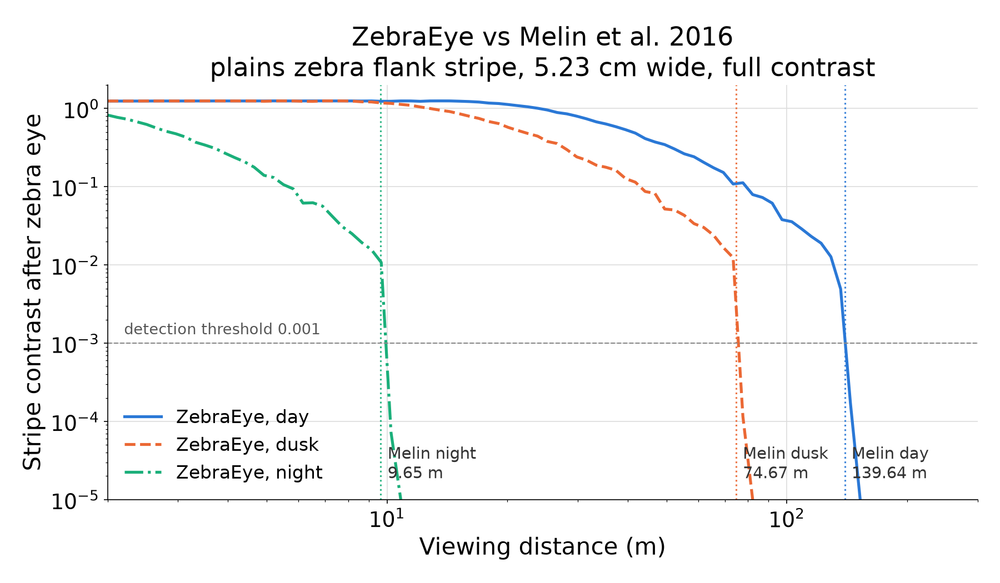

# Calibration: ZebraEye vs Melin et al. 2016 Table 2

Generated by `python -m zebrasight.calibration.melin` (411 s on the RTX 3050).
Raw numbers: `docs/calibration_results.json`. Figure: `docs/figures/calibration.png`.

## What this shows (and what it does not)

Melin's Table 2 distances follow from the acuity formula `d = 2w / tan(1/A)`; they are not
behavioural measurements. Matching them shows that **our filter's cut-off sits at the
published resolution limit** — a calibration of the implementation, not an independent
validation of the zebra eye (see docs/eye_parameters.md).

## Method

- Pipeline: geometry + dichromacy + streak (acuity map; field position 0,0) + CSF in `peli`
  mode. Motion and noise off. Linear-light black/white square-wave grating, 100% Michelson
  contrast, stripe width w (period 2w), 40 source px per period, 60 periods, 6 periods tall.
- Light levels: day = c0 (16 cd/m², 23.30 cpd), dusk = c8 (0.16 cd/m², 12.46 cpd),
  night = c9 (1.6e-5 cd/m², rod only, 1.61 cpd).
- Distance swept in 1% steps (d = d_Melin × 1.01^k, k = +15 … −40), scanning from far to near.
  Detection distance = the largest distance at which the output contrast of the grating
  fundamental in the central region (Hann-weighted least-squares fit at the known frequency,
  per row) exceeds 1e-3.
- Pass criterion: within 5% of Melin.

## 1. Acuity-only calibration: 18/18 within 5% (1% distance steps)

| Species | Stripe | Width (cm) | Light | Ours (m) | Melin (m) | Ours / Melin |
|---|---|---|---|---|---|---|
| plains | widest | 5.23 | day | 142.45 | 139.64 | 1.020 (+2.0%) |
| plains | widest | 5.23 | dusk | 76.17 | 74.67 | 1.020 (+2.0%) |
| plains | widest | 5.23 | night | 9.94 | 9.65 | 1.030 (+3.0%) |
| plains | narrowest | 1.19 | day | 32.41 | 31.77 | 1.020 (+2.0%) |
| plains | narrowest | 1.19 | dusk | 17.33 | 16.99 | 1.020 (+2.0%) |
| plains | narrowest | 1.19 | night | 2.22 | 2.20 | 1.010 (+1.0%) |
| grevys | widest | 2.83 | day | 77.08 | 75.56 | 1.020 (+2.0%) |
| grevys | widest | 2.83 | dusk | 41.22 | 40.41 | 1.020 (+2.0%) |
| grevys | widest | 2.83 | night | 5.38 | 5.22 | 1.030 (+3.0%) |
| grevys | narrowest | 1.00 | day | 27.24 | 26.70 | 1.020 (+2.0%) |
| grevys | narrowest | 1.00 | dusk | 14.57 | 14.28 | 1.020 (+2.0%) |
| grevys | narrowest | 1.00 | night | 1.90 | 1.84 | 1.030 (+3.0%) |
| mountain | widest | 6.38 | day | 173.76 | 170.34 | 1.020 (+2.0%) |
| mountain | widest | 6.38 | dusk | 92.92 | 91.09 | 1.020 (+2.0%) |
| mountain | widest | 6.38 | night | 12.13 | 11.77 | 1.030 (+3.0%) |
| mountain | narrowest | 1.41 | day | 38.41 | 37.65 | 1.020 (+2.0%) |
| mountain | narrowest | 1.41 | dusk | 20.53 | 20.13 | 1.020 (+2.0%) |
| mountain | narrowest | 1.41 | night | 2.68 | 2.60 | 1.030 (+3.0%) |

Error range +1.0% to +3.0% (mean +2.2%).

| Light | mean ours / Melin | min | max |
|---|---|---|---|
| day | 1.020 | 1.020 | 1.020 |
| dusk | 1.020 | 1.020 | 1.020 |
| night | 1.027 | 1.010 | 1.030 |

**Why ours is slightly longer than Melin.** Melin's distance is where the stripe period equals
1/A exactly. Our filter keeps the fundamental up to A·(1 + `csf.cutoff_taper`) = 1.02 A (a
raised-cosine roll-off, needed so a grating exactly at A is not lost between FFT bins), and a
square wave's fundamental has contrast 4/π = 1.27, so it is still above threshold just past A.
Both push detection 1–3% beyond Melin; they are inside the 5% tolerance and in the
expected direction.

## 2. Day acuity check (50 m, full contrast)

| Grating | Output contrast at the grating frequency | Verdict |
|---|---|---|
| 23.3 cpd | 4.66e-03 | visible |
| 26.0 cpd | 2.27e-08 | gone |

## 3. AcuityView cross-check (Caves & Johnsen 2018)

AcuityView's MTF, read from the package source, is `exp(-3.56 (R f)^2)` with R the minimum
resolvable angle in degrees (= 1/A) and f in cycles/degree (radial frequency rounded to whole
cycles per image); implementation in `zebrasight/calibration/acuityview.py`.
Our acuity-only filter is the CSF transfer H(f): 1 up to b = 0.1 A, then S(f)/c, zero beyond 1.02 A.

| f / A | ours H(f) | AcuityView MTF |
|---|---|---|
| 0.05 | 1.0000 | 0.9911 |
| 0.10 | 1.0000 | 0.9650 |
| 0.25 | 0.5382 | 0.8005 |
| 0.50 | 0.1479 | 0.4107 |
| 0.75 | 0.0500 | 0.1350 |
| 1.00 | 0.0200 | 0.0284 |
| 1.25 | 0.0000 | 0.0038 |
| 1.50 | 0.0000 | 0.0003 |

On a full-contrast wavy coat (512 × 512, 0.01 deg/px, A = 23.3 cpd):

| Stripe period | RMS contrast, ours | RMS contrast, AcuityView | RMS difference / mean |
|---|---|---|---|
| 20 px (5.0 cpd) | 0.5136 | 0.6811 | 0.1713 |
| 6 px (16.7 cpd) | 0.0492 | 0.1316 | 0.0839 |

**Difference.** Both filters put the resolution limit at the acuity (AcuityView passes 2.8%
there, ours 2%). They differ below it: ours follows the CSF shape, so mid frequencies
(0.25–0.75 A) are attenuated much more than in AcuityView's Gaussian, while AcuityView keeps a
small tail above A (0.4% at 1.25 A) that ours removes. AcuityView is an acuity (optical blur)
model only; ours adds contrast sensitivity, which is why stripes well inside the acuity limit
lose more contrast in our percept. Neither model applies a contrast threshold here.

## 4. Figure

Output contrast of the 5.23 cm plains flank stripe versus distance, one line per light level;
dotted verticals at Melin's 139.64 / 74.67 / 9.65 m; dashed horizontal = detection threshold.

## 5. Full eye: how much shorter?

Realistic stimuli: stripe contrast 0.6 (linear Michelson), wavy stripes (rows shifted by
0.15 period × sin(2π y / 3 periods), tilt ≤ 17°), then the full eye (motion stage on but static,
streak, Peli CSF, photon + neural noise). Distance found by **bisection** on log distance to 1%
(bracket 0.3–1.15 × Melin, widened if needed). With noise, each step runs 5 noise seeds in
one batch (each image gets its own seed). Detection = median contrast over the 5 seeds >
max(1e-3, 3 × the median of the same measurement on a uniform field at the grating's mean
level, also over 5 seeds). Bisection assumes detection is monotonic in distance. Round 1 is
monotonic (see figure); with noise the 5-seed median keeps it close to monotonic.

| Stimulus | mean ours / Melin | min | max |
|---|---|---|---|
| contrast 0.6 | 0.930 | 0.899 | 0.942 |
| contrast 0.6 + wavy | 0.912 | 0.894 | 0.922 |
| full eye (0.6, wavy, noise) | 0.884 | 0.839 | 0.922 |

Per entry, full eye (0.6, wavy, noise):

| Species | Stripe | Width (cm) | Light | Ours (m) | Melin (m) | Ours / Melin |
|---|---|---|---|---|---|---|
| plains | widest | 5.23 | day | 124.17 | 139.64 | 0.889 (-11.1%) |
| plains | widest | 5.23 | dusk | 68.88 | 74.67 | 0.922 (-7.8%) |
| plains | widest | 5.23 | night | 8.14 | 9.65 | 0.844 (-15.6%) |
| plains | narrowest | 1.19 | day | 28.25 | 31.77 | 0.889 (-11.1%) |
| plains | narrowest | 1.19 | dusk | 15.59 | 16.99 | 0.918 (-8.2%) |
| plains | narrowest | 1.19 | night | 1.86 | 2.20 | 0.844 (-15.6%) |
| grevys | widest | 2.83 | day | 67.19 | 75.56 | 0.889 (-11.1%) |
| grevys | widest | 2.83 | dusk | 37.28 | 40.41 | 0.922 (-7.8%) |
| grevys | widest | 2.83 | night | 4.38 | 5.22 | 0.839 (-16.1%) |
| grevys | narrowest | 1.00 | day | 23.74 | 26.70 | 0.889 (-11.1%) |
| grevys | narrowest | 1.00 | dusk | 13.17 | 14.28 | 0.922 (-7.8%) |
| grevys | narrowest | 1.00 | night | 1.54 | 1.84 | 0.839 (-16.1%) |
| mountain | widest | 6.38 | day | 151.47 | 170.34 | 0.889 (-11.1%) |
| mountain | widest | 6.38 | dusk | 83.59 | 91.09 | 0.918 (-8.2%) |
| mountain | widest | 6.38 | night | 9.93 | 11.77 | 0.844 (-15.6%) |
| mountain | narrowest | 1.41 | day | 33.48 | 37.65 | 0.889 (-11.1%) |
| mountain | narrowest | 1.41 | dusk | 18.57 | 20.13 | 0.922 (-7.8%) |
| mountain | narrowest | 1.41 | night | 2.19 | 2.60 | 0.844 (-15.6%) |

Melin's distances are acuity-only: they assume full-contrast stripes and no noise. Real
stripes (contrast 0.6, wavy) with photon and neural noise are lost earlier; the CSF's
contrast threshold, not the acuity, then sets the limit.
